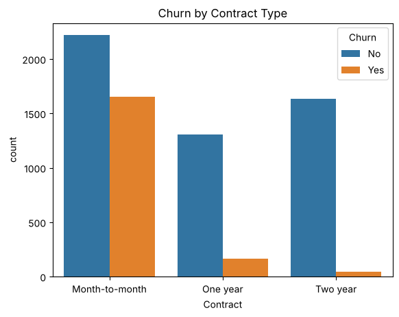
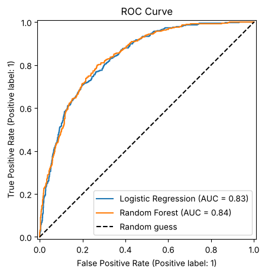
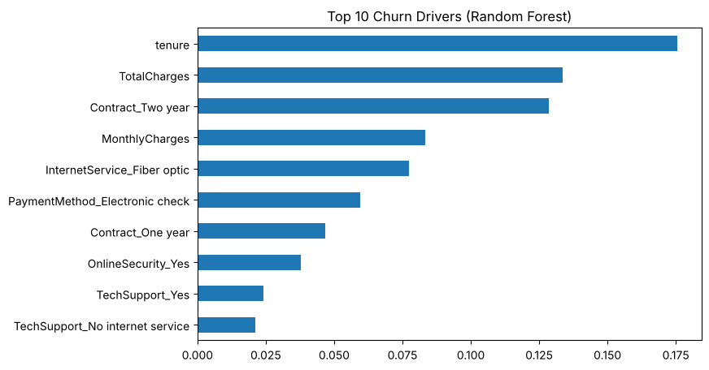

# Customer Churn Prediction

Predicting which telecom customers are likely to leave (churn), and turning the model's results into retention recommendations.

## Problem
Acquiring a new customer costs more than keeping an existing one. Using data on 7,000+ telecom customers, this project explores what drives churn, builds models to flag at-risk customers early, and suggests actions to retain them.

## Dataset
[Telco Customer Churn (Kaggle, IBM sample data)](https://www.kaggle.com/datasets/blastchar/telco-customer-churn): 7,043 customers, 21 columns (demographics, account info, services, charges, churn label).

## Approach
1. **Data cleaning:** converted `TotalCharges` from text to numeric, dropped 11 rows with missing values, removed `customerID`. Final dataset: 7,032 rows.
2. **Exploratory analysis:** churn rates by contract, tenure, charges, internet service and payment method.
3. **Preprocessing:** one-hot encoding (30 features), stratified 80/20 train-test split, `StandardScaler` fitted on training data only to avoid data leakage.
4. **Modelling:** Logistic Regression and Random Forest, both with `class_weight="balanced"` to handle class imbalance (26.6% churn).
5. **Evaluation:** accuracy, precision, recall, F1, ROC-AUC, confusion matrix and ROC curve on the held-out test set.

## Key findings
| Segment | Churn rate |
|---|---|
| Overall | 26.6% |
| Month-to-month contract | 42.7% |
| Two-year contract | 2.8% |
| Tenure 0–12 months | 47.7% |
| Tenure 49–72 months | 9.5% |
| Fiber optic internet | 41.9% |
| Electronic check payment | 45.3% |

Customers who churn have a higher median monthly bill (79.65 vs 64.45).

## Results (test set, 1,407 customers)
| Model | Accuracy | Precision | Recall | F1 | ROC-AUC |
|---|---|---|---|---|---|
| Logistic Regression | 0.726 | 0.491 | 0.797 | 0.608 | 0.835 |
| **Random Forest** | **0.739** | **0.506** | **0.802** | **0.620** | **0.838** |

Random Forest was selected. It catches **80% of churners** (300 of 374) in the test set. Recall was prioritised over precision, because missing a churner costs more than offering a retention discount to a customer who would have stayed.

## Churn drivers

The top drivers are tenure, total charges, contract type, monthly charges, fiber optic internet and electronic check payment.

## Recommendations
1. **Contract upgrades:** offer month-to-month customers discounts to move to 1- or 2-year plans (42.7% vs 2.8% churn).
2. **First-year onboarding:** focus retention on customers in their first 12 months (47.7% churn).
3. **Auto-pay and support bundles:** encourage electronic-check users to switch to auto-pay, and offer Tech Support / Online Security bundles to fiber customers.

A high-risk segment (churn probability > 70%) of 313 test customers was all on month-to-month plans, with an average tenure of 7.9 months; 62% of them actually churned.

## Tech stack
Python, pandas, NumPy, scikit-learn, Matplotlib, Seaborn, Google Colab

## Run it
1. Download the CSV from Kaggle and place it next to the notebook.
2. Open `customer_churn.ipynb` in Google Colab or Jupyter and run all cells.
